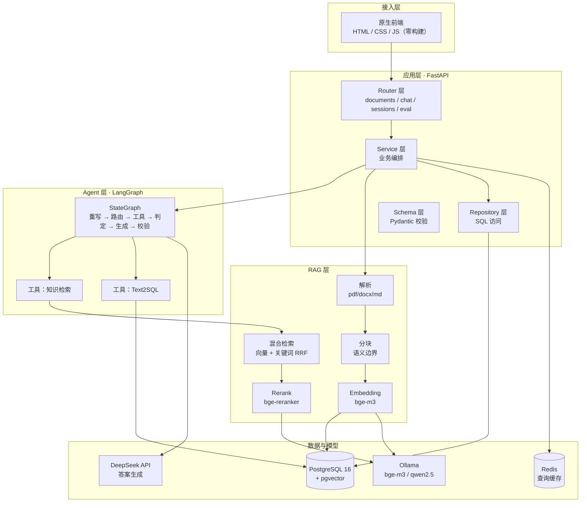

# 企业知识库与 Agent 智能问答平台 · 技术方案

> 版本 v1.0 ｜ 2026-11-07 ｜ 个人开发项目
> 目标：3 周内交付可演示、可评测、可写进简历的完整系统

---

## 1. 项目定位

一句话：**让员工用自然语言问企业内部资料，答案带出处；问题超出文档范围时，自动转成 SQL 去查业务数据库。**

三个必须能演示的能力，也是三个验收点：

| 验收点 | 判定方式 |
|---|---|
| 文档问答带引用溯源 | 回答里的 `[1][2]` 能点开看到原文片段、文件名、页码 |
| 多工具协同（Agent） | 一句"结合判定标准分析上月偏差"，系统同时调知识库和 SQL 并汇总 |
| 有量化评测报告 | 40 条测试集的命中率、延迟、Token 对比表，含 Badcase 归因 |

**明确不做**（写在这里是为了防止自己中途跑偏）：

- 不做 Vue/React 前端，用原生 HTML/CSS/JS（零构建工具，浏览器直开）
- 不做模型微调，只用 Prompt 工程 + RAG
- 不做多租户、组织架构、RBAC 五表，只保留 JWT 单用户登录
- 不做语音、不做多模态、不做信创系统适配
- 不接入 Dify，编排全部用 LangGraph 手写（这是面试主战场）

---

## 2. 总体架构



### 一次提问的完整链路

1. 前端 POST `/api/chat/stream`，带 `session_id` + `question`
2. 后端生成 `trace_id`，写入会话表，立即回 `event: meta`
3. LangGraph 启动：**query 重写**（消除指代，如"它"→"3 号车间偏差"）
4. **意图路由**：判断走知识库、走 SQL、两者都要、还是直接闲聊
5. 并行执行工具：知识库走「向量检索 + 关键词检索 → RRF 融合 → Rerank 精排」，SQL 走「三层兜底生成 → 安全校验 → 执行」
6. **相关性判定**：检索结果最高分低于阈值 → 回到第 3 步重写，最多 2 次
7. **生成**：拼装 Prompt（上下文片段 + SQL 结果 + 引用编号规则），DeepSeek 流式输出，逐 token 推给前端
8. **引用校验**：检查回答里的 `[n]` 是否都在 citations 里，越界的编号剔除；最后推 `event: usage` 和 `event: done`

---

## 3. 技术选型与决策记录

这张表是给人问"为什么不用 XX"准备的，面试直接用。

| 层次 | 选型 | 为什么是它 | 放弃了什么，为什么 |
|---|---|---|---|
| Web 框架 | FastAPI + Pydantic v2 | 异步原生、SSE 好写、自动生成 OpenAPI 文档 | Django 太重；Flask 缺异步和校验 |
| Agent 编排 | LangGraph | 图结构可显式表达状态、条件边、循环重试，能讲清原理 | **Dify**：拖拽黑盒，面试问"怎么实现的"答不出；LangChain AgentExecutor：抽象过厚，调试困难 |
| 向量库 | pgvector | 和业务库同源，一条 SQL 搞定向量+元数据+权限过滤，事务一致 | Milvus/Qdrant 要多维护一个服务；Chroma 生产性弱 |
| 关键词检索 | PostgreSQL `tsvector` + 中文 bigram | 不加组件就实现混合检索 | Elasticsearch 太重；`zhparser` 不在官方镜像里，装扩展增加部署风险 |
| Embedding | bge-m3（1024 维） | 中英文都好、支持长文本、Ollama 直接拉 | OpenAI embedding 要外网且要钱 |
| Rerank | bge-reranker-v2-m3 | CPU 可跑，中文效果好 | Cohere Rerank 收费；不接 Rerank 效果掉一档 |
| 生成模型 | DeepSeek API | 便宜、中文强、支持流式 | 本地跑 32B 需要显卡，个人项目成本不划算 |
| 会话持久化 | LangGraph PostgresSaver | 复用同一个 PostgreSQL，不用额外引组件 | Redis checkpointer 要额外维护 |
| 缓存 | Redis | 缓存 embedding 和重复问题结果 | 内存字典重启即失效 |
| 部署 | Docker Compose | 一条命令拉起全套，面试现场能演示 | K8s 校招不要求，纯负担 |
| 前端 | 原生 HTML/CSS/JS | 零构建零依赖，手写 SSE 解析能讲清原理 | Streamlit 刷新感强、引用卡片难动态插入；Vue/React 要引构建链，多花 3 天对简历无实质加分 |

### 三个关键技术判断（面试加分点）

**① 为什么中文关键词检索要用 bigram 而不是直接 `to_tsvector`**

PostgreSQL 默认分词器不认识中文，"偏差分析"会被当成一整个词，检索不到"偏差"。解决方式是在应用层把文本切成两字组合后存进去：

```python
# app/rag/tokenize.py
import re

def to_bigram(text: str) -> str:
    """中文 bigram 切分，供 PostgreSQL simple 分词器做全文检索"""
    text = re.sub(r"[\s\u3000]+", "", text)
    text = re.sub(r"[^\w\u4e00-\u9fa5]+", " ", text)
    out = []
    for seg in text.split():
        if re.search(r"[\u4e00-\u9fa5]", seg):
            out.extend(seg[i:i + 2] for i in range(len(seg) - 1))
        else:
            out.append(seg.lower())
    return " ".join(out)
```

入库时同时写 `content_bigram` 和 `content_tsv = to_tsvector('simple', content_bigram)`。

> **更优解（可选升级）**：`pg_bigm` 扩展专门为 CJK 设计，装好之后可以用 `gin_bigm_ops` 索引加速 `LIKE '%词%'`，并按 `bigm_similarity()` 排序，省掉应用层切分。代价是首次启动要用 `apt-get + gcc` 编译，**离线部署会失败**。Dify 官方镜像的 `pgvector/docker-entrypoint.sh` 里有现成写法（`PG_BIGM=true` 触发），可以直接抄。个人项目有网时选它，公司内网选上面的 bigram 方案。

**② 为什么用 RRF 融合而不是加权求和**

向量分是余弦相似度（0~1），关键词分是 `ts_rank_cd`（无上界），两者量纲不同，加权求和要反复调参且不稳定。RRF 只用**排名**不用分数，天然免疫量纲问题：

```
score(d) = Σ 1 / (k + rank_i(d))，k 取 60
```

**③ 为什么 Text2SQL 要做三层兜底**

直接让大模型生成 SQL 就跑，三个问题必现：字段名幻觉、漏 `WHERE` 条件扫全表、生成 `DELETE`。三层兜底按成本从低到高兜：

| 层 | 策略 | 命中场景 | 成本 |
|---|---|---|---|
| L1 | 规则路由：关键词 → 预置 SQL 模板 | "偏差最大""本月产量"等高频固定问法 | 0 次 LLM 调用 |
| L2 | 语义匹配 `sql_templates` 表里的历史模板 | 措辞不同但意图相同 | 1 次向量检索 |
| L3 | LLM 生成（注入 DDL + 字段注释 + 3 条 few-shot） | 复杂组合条件 | 1 次 LLM + 1 次校验 |

---

## 4. 数据模型

### 4.1 建表 SQL

```sql
CREATE EXTENSION IF NOT EXISTS vector;
CREATE EXTENSION IF NOT EXISTS pg_trgm;

-- 用户（极简，够登录即可）
CREATE TABLE users (
    id            BIGSERIAL PRIMARY KEY,
    username      TEXT NOT NULL UNIQUE,
    password_hash TEXT NOT NULL,
    created_at    TIMESTAMPTZ NOT NULL DEFAULT now()
);

-- 文档
CREATE TABLE documents (
    id          BIGSERIAL PRIMARY KEY,
    title       TEXT NOT NULL,
    source_type TEXT NOT NULL,                    -- pdf / docx / md / txt
    file_path   TEXT NOT NULL,
    file_hash   CHAR(64) NOT NULL,                -- sha256，秒传去重
    file_size   BIGINT,
    page_count  INT,
    status      TEXT NOT NULL DEFAULT 'pending',  -- pending/parsing/indexing/ready/failed
    error_msg   TEXT,
    chunk_count INT NOT NULL DEFAULT 0,
    created_at  TIMESTAMPTZ NOT NULL DEFAULT now(),
    updated_at  TIMESTAMPTZ NOT NULL DEFAULT now()
);
CREATE UNIQUE INDEX ux_documents_hash ON documents (file_hash);

-- 分块（检索的最小单元）
CREATE TABLE chunks (
    id             BIGSERIAL PRIMARY KEY,
    doc_id         BIGINT NOT NULL REFERENCES documents(id) ON DELETE CASCADE,
    seq            INT NOT NULL,
    content        TEXT NOT NULL,
    content_bigram TEXT NOT NULL,
    content_tsv    tsvector,
    embedding      vector(1024),
    page_no        INT,
    section_path   TEXT,                          -- "第3章 > 3.2 偏差判定标准"
    token_count    INT,
    created_at     TIMESTAMPTZ NOT NULL DEFAULT now()
);
CREATE INDEX ix_chunks_doc  ON chunks (doc_id, seq);
CREATE INDEX ix_chunks_tsv  ON chunks USING gin (content_tsv);
CREATE INDEX ix_chunks_vec  ON chunks USING hnsw (embedding vector_cosine_ops)
    WITH (m = 16, ef_construction = 64);

-- 会话 / 消息
CREATE TABLE sessions (
    id         UUID PRIMARY KEY DEFAULT gen_random_uuid(),
    user_id    BIGINT NOT NULL REFERENCES users(id),
    title      TEXT,
    created_at TIMESTAMPTZ NOT NULL DEFAULT now(),
    updated_at TIMESTAMPTZ NOT NULL DEFAULT now()
);

CREATE TABLE messages (
    id         BIGSERIAL PRIMARY KEY,
    session_id UUID NOT NULL REFERENCES sessions(id) ON DELETE CASCADE,
    role       TEXT NOT NULL,        -- user / assistant / tool
    content    TEXT,
    citations  JSONB,                -- [{chunk_id, doc_id, doc_name, page_no, snippet, score}]
    tool_calls JSONB,
    token_in   INT,
    token_out  INT,
    latency_ms INT,
    trace_id   TEXT,
    created_at TIMESTAMPTZ NOT NULL DEFAULT now()
);
CREATE INDEX ix_messages_session ON messages (session_id, created_at);

-- SQL 模板库（Text2SQL 第二层兜底）
CREATE TABLE sql_templates (
    id          BIGSERIAL PRIMARY KEY,
    question    TEXT NOT NULL,
    sql_text    TEXT NOT NULL,
    embedding   vector(1024),
    hit_count   INT NOT NULL DEFAULT 0,
    created_at  TIMESTAMPTZ NOT NULL DEFAULT now()
);

-- 评测
CREATE TABLE eval_runs (
    id             BIGSERIAL PRIMARY KEY,
    name           TEXT NOT NULL,
    config         JSONB,            -- 检索参数快照：top_k / rrf_k / rerank 开关
    hit_rate       NUMERIC(5,4),
    mrr            NUMERIC(5,4),
    citation_acc   NUMERIC(5,4),
    p50_ms         INT,
    p95_ms         INT,
    avg_token_in   INT,
    avg_token_out  INT,
    created_at     TIMESTAMPTZ NOT NULL DEFAULT now()
);

CREATE TABLE eval_cases (
    id               BIGSERIAL PRIMARY KEY,
    run_id           BIGINT NOT NULL REFERENCES eval_runs(id) ON DELETE CASCADE,
    question         TEXT NOT NULL,
    ground_truth     TEXT,
    relevant_chunk_ids BIGINT[],
    retrieved_ids    BIGINT[],
    answer           TEXT,
    cited_ids        BIGINT[],
    hit              BOOLEAN,
    reciprocal_rank  NUMERIC(5,4),
    citation_ok      BOOLEAN,
    badcase_type     TEXT,   -- retrieve_miss/rank_fail/context_noise/hallucination/refuse
    latency_ms       INT,
    token_in         INT,
    token_out        INT
);
```

LangGraph 的 checkpointer 表由 `PostgresSaver.setup()` 自动创建（`checkpoints`、`checkpoint_writes` 等），无需手写。

### 4.2 表关系

```
users 1──n sessions 1──n messages
documents 1──n chunks
eval_runs 1──n eval_cases
```

---

## 5. 核心模块设计

### 5.1 文档接入

支持 `pdf / docx / md / txt`。PDF 用 `PyMuPDF`（速度和中文提取都优于 pdfplumber）：

```python
# app/rag/parse.py
import fitz
from docx import Document as Docx

def parse_pdf(path: str) -> list[dict]:
    """返回 [{text, page_no, section_path}]"""
    pages = []
    with fitz.open(path) as doc:
        for i, page in enumerate(doc, start=1):
            text = page.get_text("text").strip()
            if text:
                pages.append({"text": text, "page_no": i})
    return pages
```

要点：
- **保留页码**，这是引用溯源的前提
- 表格文本单独标记 `<TABLE>` 包裹，否则会被切碎
- 解析失败要落 `documents.error_msg`，不能让接口静默 200
- 上传后立即返回 `doc_id` + `status=pending`，解析放后台任务（`BackgroundTasks` 即可，不用上 Celery）

### 5.2 分块策略

不追新，用最稳的一条：**按语义分隔符递归切，目标 512 token，重叠 80 token，优先在标题边界断。**

```python
# app/rag/chunk.py
SEPARATORS = ["\n## ", "\n### ", "\n\n", "\n", "。", "！", "？", "；", " "]

def chunk_text(text: str, target: int = 512, overlap: int = 80) -> list[str]:
    # 递归按分隔符切，合并到接近 target，尾部保留 overlap
    ...
```

为什么不用"固定长度切分"：会把一句话拦腰砍断，Rerank 和生成都受影响，评测时能明显看出差距。

分块时把 `section_path`（当前所在的标题链）一起写进 chunk 元数据，检索时拼进 Prompt，能大幅减少"答非所问"。

### 5.3 向量化

Ollama 拉 `bge-m3`，批处理走 `/api/embed`：

```python
# app/rag/embed.py
import httpx
from tenacity import retry, stop_after_attempt, wait_exponential

@retry(stop=stop_after_attempt(3), wait=wait_exponential(min=1, max=8))
async def embed_batch(texts: list[str]) -> list[list[float]]:
    async with httpx.AsyncClient(timeout=120) as cli:
        r = await cli.post(
            f"{settings.OLLAMA_BASE}/api/embed",
            json={"model": "bge-m3", "input": texts},
        )
        r.raise_for_status()
        return r.json()["embeddings"]
```

注意：**同一批文档必须用同一个 embedding 模型**。换模型 = 维度或语义空间变了 = 全量重算。在 `documents` 之外建议加一张 `system_config` 记 `embedding_model` 版本，换模型时校验。

### 5.4 混合检索（向量 + 关键词 + RRF）

一条 SQL 完成两路召回和融合，这是选 pgvector 最大的收益：

```sql
-- 参数：$1=查询向量, $2=关键词bigram串, $3=每路召回数, $4=最终返回数
WITH vec AS (
    SELECT id, ROW_NUMBER() OVER (ORDER BY embedding <=> $1) AS rk
    FROM chunks
    WHERE embedding IS NOT NULL
    ORDER BY embedding <=> $1
    LIMIT $3
),
kw AS (
    SELECT id, ROW_NUMBER() OVER (
               ORDER BY ts_rank_cd(content_tsv, plainto_tsquery('simple', $2)) DESC
           ) AS rk
    FROM chunks
    WHERE content_tsv @@ plainto_tsquery('simple', $2)
    LIMIT $3
),
merged AS (
    SELECT id, 1.0 / (60 + rk) AS s FROM vec
    UNION ALL
    SELECT id, 1.0 / (60 + rk) AS s FROM kw
)
SELECT c.id, c.doc_id, c.content, c.page_no, c.section_path,
       d.title AS doc_name, SUM(m.s) AS rrf_score
FROM merged m
JOIN chunks c ON c.id = m.id
JOIN documents d ON d.id = c.doc_id
GROUP BY c.id, c.doc_id, c.content, c.page_no, c.section_path, d.title
ORDER BY rrf_score DESC
LIMIT $4;
```

参数取值：两路各召回 30，融合后取 20 送 Rerank，Rerank 后取 5 进 Prompt。这三个数是评测调出来的，初始值够用。

**关键**：`ORDER BY embedding <=> $1` 才能命中 HNSW 索引；写成 `ORDER BY 1 - (embedding <=> $1) DESC` 会退化成全表扫描。

### 5.5 Rerank

独立的轻量服务，避免污染主进程内存（模型加载占 1~2G）：

```python
# services/reranker/main.py
from fastapi import FastAPI
from FlagEmbedding import FlagReranker

app = FastAPI()
reranker = FlagReranker("BAAI/bge-reranker-v2-m3", use_fp16=False)

@app.post("/rerank")
def rerank(payload: dict):
    pairs = [[payload["query"], d] for d in payload["docs"]]
    scores = reranker.compute_score(pairs, normalize=True)
    return {"scores": scores}
```

`docker-compose` 里独立成服务，主应用 HTTP 调用。**这层是命中率提升最明显的一环**，评测对比会看到。

### 5.6 LangGraph Agent 设计

#### State 定义

```python
# app/agent/state.py
from typing import Annotated, Literal, TypedDict
from langgraph.graph.message import add_messages

class Citation(TypedDict):
    chunk_id: int
    doc_id: int
    doc_name: str
    page_no: int | None
    snippet: str
    score: float

class AgentState(TypedDict):
    messages: Annotated[list, add_messages]   # 对话历史
    query: str                                # 原始问题
    rewritten: str                            # 重写后的问题
    route: Literal["kb", "sql", "both", "direct"]
    retrieved: list[dict]                     # 知识库召回
    sql_result: dict | None                   # SQL 执行结果
    citations: list[Citation]
    answer: str
    retry: int                                # 重试次数，上限 2
    usage: dict                               # token_in / token_out
    timings: dict                             # 各节点耗时
    error: str | None
```

#### 图的组装

```python
# app/agent/graph.py
from langgraph.graph import StateGraph, START, END
from langgraph.checkpoint.postgres import PostgresSaver

from app.agent.state import AgentState
from app.agent import nodes

def build_graph(checkpointer: PostgresSaver):
    g = StateGraph(AgentState)

    g.add_node("rewrite",   nodes.rewrite)      # 指代消解 + 口语转书面
    g.add_node("route",     nodes.route)        # 意图分类
    g.add_node("retrieve",  nodes.retrieve)     # 知识库工具
    g.add_node("text2sql",  nodes.text2sql)     # SQL 工具
    g.add_node("merge",     nodes.merge)        # 多工具结果汇总
    g.add_node("grade",     nodes.grade)        # 检索质量判定
    g.add_node("generate",  nodes.generate)     # 调 DeepSeek 流式生成
    g.add_node("verify",    nodes.verify)       # 引用编号校验

    g.add_edge(START, "rewrite")
    g.add_edge("rewrite", "route")

    # 条件分叉
    g.add_conditional_edges("route", nodes.route_selector, {
        "kb": "retrieve",
        "sql": "text2sql",
        "both": "retrieve",     # both 先走 retrieve，retrieve 内部再扇出
        "direct": "generate",
    })

    g.add_edge("retrieve", "merge")
    g.add_edge("text2sql", "merge")
    g.add_edge("merge", "grade")

    # 质量不达标 → 回到重写（自反思循环）
    g.add_conditional_edges("grade", nodes.grade_selector, {
        "retry": "rewrite",
        "pass": "generate",
    })

    g.add_edge("generate", "verify")
    g.add_edge("verify", END)

    return g.compile(checkpointer=checkpointer)
```

#### 三个关键节点的实现要点

**route —— 用结构化输出而非 Prompt 解析**

```python
# app/agent/nodes.py
ROUTE_PROMPT = """判断用户问题应该由哪种工具回答：
- kb：询问制度、标准、流程、文档内容 → 知识库检索
- sql：询问具体数值、排名、统计、趋势 → 查数据库
- both：既需要标准/规则，又需要实际数据 → 两者都要
- direct：寒暄、与业务无关 → 直接回答
只输出一个词。"""

async def route(state: AgentState) -> dict:
    resp = await llm.chat(ROUTE_PROMPT, state["rewritten"], temperature=0)
    label = resp.strip().lower()
    if label not in {"kb", "sql", "both", "direct"}:
        label = "kb"          # 兜底，宁可查知识库
    return {"route": label}
```

**grade —— 决定要不要重试**

```python
async def grade(state: AgentState) -> dict:
    if state["route"] in ("sql", "direct"):
        return {"retry": state["retry"]}
    top = state["retrieved"][0]["score"] if state["retrieved"] else 0.0
    # 阈值从评测里调，初始 0.3（Rerank 归一化后的分数）
    return {"retrieved": state["retrieved"]} if top >= 0.3 else {"retrieved": []}

def grade_selector(state: AgentState) -> str:
    if state["route"] in ("sql", "direct"):
        return "pass"
    if not state["retrieved"] and state["retry"] < 2:
        return "retry"
    return "pass"
```

重试时 `rewrite` 节点会换一种表述再检索一次。**这个自反思循环是 LangGraph 相对普通 Chain 的核心价值**，面试必讲。

**generate —— 带引用编号的 Prompt**

```python
ANSWER_PROMPT = """你是企业知识库助手。仅依据下面的【参考资料】回答，不要编造。

规则：
1. 每处结论后用 [1] [2] 标注来源编号，编号对应参考资料序号
2. 参考资料未覆盖的内容，直接回答"现有资料中未找到相关内容"
3. 回答使用简洁的中文，必要时用列表

【参考资料】
{context}

【问题】{question}"""
```

`context` 的拼装格式固定带上来源信息，模型才知道编号怎么给：

```
[1]（来源：设备管理规定.pdf · 第 12 页 · 3.2 偏差判定标准）
偏差超过 5% 且持续 2 小时以上，判定为异常...

[2]（来源：车间运行手册.docx · 第 5 页 · 2.1 数据采集频率）
...
```

### 5.7 SSE 流式协议

前后端约定的事件类型（前端和 Streamlit 都按这个解析）：

| event | data | 时机 |
|---|---|---|
| `meta` | `{session_id, trace_id}` | 连接建立，立刻发 |
| `route` | `{route}` | 意图判定完成 |
| `citation` | `{citations: [...]}` | 检索完成，前端先渲染来源卡片 |
| `token` | `{delta}` | 每个 LLM token |
| `usage` | `{token_in, token_out, latency_ms}` | 生成结束 |
| `error` | `{code, message}` | 任意环节异常 |
| `done` | `{}` | 结束 |

```python
# app/api/v1/chat.py
def sse(event: str, data: dict) -> str:
    return f"event: {event}\ndata: {json.dumps(data, ensure_ascii=False)}\n\n"

@router.post("/chat/stream")
async def chat_stream(req: ChatRequest, user=Depends(current_user)):
    async def gen():
        yield sse("meta", {"session_id": str(sid), "trace_id": trace_id})
        try:
            async for ev in graph.astream_events(state, config, version="v2"):
                if ev["event"] == "on_chat_model_stream":
                    delta = ev["data"]["chunk"].content
                    if delta:
                        yield sse("token", {"delta": delta})
                elif ev["event"] == "on_chain_end" and ev["name"] == "retrieve":
                    yield sse("citation", {"citations": ev["data"]["output"]["citations"]})
            yield sse("usage", usage)
        except Exception as e:
            yield sse("error", {"code": "INTERNAL", "message": str(e)})
        finally:
            yield sse("done", {})

    return StreamingResponse(gen(), media_type="text/event-stream", headers={
        "Cache-Control": "no-cache",
        "Connection": "keep-alive",
        "X-Accel-Buffering": "no",   # 关键：禁用 Nginx 缓冲，否则会被攒成一批
    })
```

**三个必踩的坑提前说：**
1. 不加 `X-Accel-Buffering: no`，前面挂 Nginx 后流式会变成"一次性吐出"。Nginx 侧也要关缓冲，配置直接抄 Dify 的 `nginx/proxy.conf.template`：

```nginx
location /api/chat/stream {
    proxy_pass http://app:8000;
    proxy_http_version 1.1;
    proxy_set_header Connection "";
    proxy_buffering off;              # 关键
    proxy_cache off;
    proxy_read_timeout 3600s;          # 流式必须给长超时
    proxy_send_timeout 3600s;
    proxy_set_header X-Forwarded-For $proxy_add_x_forwarded_for;
}
```

2. **原生 `EventSource` 不能用**：它只支持 GET、不能带 `Authorization` 头、不能发 body。必须用 `fetch` + `ReadableStream` 手动解析（见 5.9）
3. 生成器里必须有 `try/except` 并推 `error` 事件，否则前端会一直转圈拿不到 `done`


### 5.8 引用溯源

这是本项目最拿得出手的功能，实现要克制：

1. `citations` 直接来自 Rerank 后的 top-k，`snippet` 截取 chunk 前 120 字
2. Prompt 里硬性要求输出 `[n]` 编号
3. `verify` 节点做正则抽取：`re.findall(r"\[(\d+)\]", answer)`，把所有编号和 citations 长度比对，越界的编号从回答里删掉
4. 前端点击 `[1]` 弹出 Drawer，展示完整 chunk + 文件名 + 页码

```python
def verify(state: AgentState) -> dict:
    answer = state["answer"]
    valid = len(state["citations"])
    def _fix(m):
        n = int(m.group(1))
        return m.group(0) if 1 <= n <= valid else ""
    return {"answer": re.sub(r"\[(\d+)\]", _fix, answer)}
```

### 5.9 前端实现（原生 HTML / CSS / JS）

技术判断：**这个项目用原生三件套完全够，而且比 Streamlit 更适合演示。**

- Streamlit 每次交互重跑整个脚本，消息列表和引用卡片要动态插入很别扭，页面还有明显刷新感
- Vue/React 要引构建链，多出来的时间对简历没有实质加分
- 原生的代价只是：手写 SSE 解析（约 30 行）+ 手写 DOM 追加

页面结构走两栏：左侧文档库（上传 + 列表 + 索引进度），右侧对话区（消息流 + 底部输入框）。引用不弹窗，直接在回答底部渲染成一排可点的小卡片，更简单也更好看。

**核心：fetch 流式解析（`EventSource` 用不了，原因见 5.7）**

```js
// frontend/app.js
const TOKEN = sessionStorage.getItem('token');

async function ask(question) {
  const resp = await fetch('/api/chat/stream', {
    method: 'POST',
    headers: {
      'Content-Type': 'application/json',
      'Authorization': `Bearer ${TOKEN}`,
    },
    body: JSON.stringify({ session_id: SESSION_ID, question }),
  });
  if (!resp.ok) throw new Error(`HTTP ${resp.status}`);

  const reader = resp.body.getReader();
  const decoder = new TextDecoder();
  let buf = '';

  while (true) {
    const { done, value } = await reader.read();
    if (done) break;
    buf += decoder.decode(value, { stream: true }).replace(/\r\n/g, '\n');

    let idx;
    while ((idx = buf.indexOf('\n\n')) >= 0) {   // SSE 以空行分帧
      dispatch(buf.slice(0, idx));
      buf = buf.slice(idx + 2);
    }
  }
  finish();
}

function dispatch(frame) {
  let event = 'message';
  let data = '';
  for (const line of frame.split('\n')) {
    if (line.startsWith('event:')) event = line.slice(6).trim();
    else if (line.startsWith('data:')) data += line.slice(5).trim();
  }
  if (!data) return;
  const p = JSON.parse(data);

  if (event === 'citation') renderCitations(p.citations);
  else if (event === 'token') appendToken(p.delta);
  else if (event === 'error') showError(p.message);
  else if (event === 'usage') showUsage(p);
}
```

**渲染节流**：每个 token 都重渲染 Markdown 会卡，用 `requestAnimationFrame` 合并：

```js
let raw = '', ticking = false;

function appendToken(delta) {
  raw += delta;
  if (ticking) return;
  ticking = true;
  requestAnimationFrame(() => {
    bubble.innerHTML = DOMPurify.sanitize(marked.parse(raw));
    ticking = false;
    scrollToBottom();
  });
}
```

**两个必须引的 CDN**（各一行，不需要 npm）：

```html
<script src="https://cdn.jsdelivr.net/npm/marked/marked.min.js"></script>
<script src="https://cdn.jsdelivr.net/npm/dompurify/dist/purify.min.js"></script>
```

`DOMPurify` 不是可选项——模型输出是不可信内容，直接 `innerHTML` 注入会被 XSS。**这一点面试官很可能会问**，"你为什么做前端转义"是个很好的安全题切入点。

CSS 只需要写：`.app` 用 `display: grid; grid-template-columns: 260px 1fr`，消息气泡 `max-width: 78%`，引用卡片 `display: flex; flex-wrap: wrap`，输入框 `position: sticky; bottom: 0`。100 行以内能写完，不要用任何 UI 框架。

**工作量对比**：原生 ≈ 2 天（含上传、进度轮询、流式渲染、引用卡片）；Vue3 + 构建链 ≈ 5 天。省下的 3 天全部投到评测上，收益高得多。

---

## 6. 接口设计

| 方法 | 路径 | 说明 |
|---|---|---|
| POST | `/api/auth/login` | 用户名密码换 JWT |
| POST | `/api/documents` | 上传文档，立即返回 `doc_id` |
| GET | `/api/documents` | 文档列表（含 `status`、`chunk_count`） |
| GET | `/api/documents/{id}` | 详情 + 分块预览 |
| DELETE | `/api/documents/{id}` | 级联删除 chunks |
| POST | `/api/documents/{id}/reindex` | 重新解析索引 |
| POST | `/api/sessions` | 新建会话 |
| GET | `/api/sessions/{id}/messages` | 历史消息（含 citations） |
| POST | `/api/chat/stream` | **SSE 流式问答** |
| GET | `/api/eval/runs` | 评测批次列表 |
| POST | `/api/eval/run` | 触发一次批量评测 |
| GET | `/api/health` | 健康检查（DB / Ollama / DeepSeek 连通性） |

统一响应体（流式接口除外）：

```json
{ "code": 0, "message": "ok", "data": {} }
```

异常统一由 `@app.exception_handler` 收敛，`code` 非 0 时 `data` 为 `null`。

---

## 7. 性能与缓存

| 手段 | 做法 | 预期收益 |
|---|---|---|
| 结果缓存 | Redis 键 `qa:{md5(question)}`，存 answer + citations，TTL 1 小时 | 重复问题省掉 1 次 LLM，P95 从 4s 降到 50ms |
| Embedding 缓存 | Redis 键 `emb:{md5(text)}`，永久 | 重索引时省 90% 调用 |
| 向量索引预热 | `SET hnsw.ef_search = 100`（连接级） | 召回率提升，延迟几乎不变 |
| 并发控制 | `asyncio.Semaphore(8)` 限制同时调 DeepSeek | 避免 429 |
| 分页 | 文档列表强制 `LIMIT`，禁止全量返回 | 防慢查询 |
| 慢日志 | 中间件记录 `trace_id + 耗时 > 1s` 的请求 | 定位瓶颈 |

目标指标（写进简历用）：**首字延迟 < 1s，完整回答 P95 < 6s，检索阶段 P95 < 400ms。**

---

## 8. 质量评测体系

### 8.1 测试集

`eval/dataset/qa.jsonl`，40 条，覆盖四类：

```jsonl
{"id":"q001","type":"fact","question":"偏差超过多少判定为异常？","ground_truth":"偏差超过 5% 且持续 2 小时以上","relevant_chunk_ids":[12],"relevant_doc":"设备管理规定.pdf"}
{"id":"q002","type":"multi_hop","question":"3号车间上周偏差最大的设备，它的判定标准是什么？","route":"both"}
{"id":"q003","type":"sql","question":"上月各车间平均偏差率排名","route":"sql"}
{"id":"q004","type":"unanswerable","question":"明年公司的战略目标是什么？","expect":"未找到相关内容"}
```

四类各 10 条。**`unanswerable` 这一类最容易被忽略，但最能体现系统成熟度**——考察模型会不会在没资料时硬编。

### 8.2 指标口径

| 指标 | 定义 | 目标 |
|---|---|---|
| Hit@5 | 前 5 条召回里含标准答案所在 chunk 的比例 | ≥ 0.85 |
| MRR | 第一条相关 chunk 的排名倒数均值 | ≥ 0.70 |
| 引用准确率 | 回答中的引用确实支撑该结论的比例（人工/LLM 判定） | ≥ 0.90 |
| 拒答正确率 | `unanswerable` 类正确拒答的比例 | ≥ 0.80 |
| P50 / P95 延迟 | 首字延迟、整体延迟 | 1s / 6s |
| Token 消耗 | 平均输入 / 输出 token | 记录基线 |

### 8.3 三组对照实验（简历数字来源）

| 组 | 配置 | 观察 |
|---|---|---|
| A | 纯向量检索 top5 | 基线 |
| B | 向量 + 关键词 RRF top20 → 取 5 | 看混合检索增益 |
| C | 向量 + 关键词 RRF top20 → Rerank 取 5 | 看精排增益 |

跑完得到一条"命中率从 A 到 C 提升了多少"的曲线，**这个数字比任何技术名词都有说服力**。把三组结果写进 `eval_report.md`，README 里放表格截图。

### 8.4 Badcase 归因

每条失败样本必打一个标签，这是优化的依据：

| 标签 | 含义 | 典型改进 |
|---|---|---|
| `retrieve_miss` | 检索完全没召回相关 chunk | 调整分块粒度、加同义词 |
| `rank_fail` | 召回了但排在后面 | 加 Rerank、调 RRF 权重 |
| `context_noise` | 召回了无关内容干扰 | 提高阈值、减少 top-k |
| `hallucination` | 有资料但答案编造 | 收紧 Prompt、降温度 |
| `refuse` | 该答却拒答 | 降低阈值、优化 Prompt |

---

## 9. 部署方案

`docker-compose.yml`：

```yaml
services:
  db:
    image: pgvector/pgvector:pg16
    environment:
      POSTGRES_DB: kb
      POSTGRES_USER: kb
      POSTGRES_PASSWORD: ${DB_PASSWORD}
    volumes:
      - pgdata:/var/lib/postgresql/data
      - ./scripts/init.sql:/docker-entrypoint-initdb.d/01-init.sql
    healthcheck:
      test: ["CMD-SHELL", "pg_isready -U kb -d kb"]
      interval: 5s
      retries: 10

  redis:
    image: redis:7-alpine
    command: redis-server --appendonly yes
    volumes:
      - redisdata:/data

  ollama:
    image: ollama/ollama
    volumes:
      - ollamadata:/root/.ollama
    ports:
      - "11434:11434"

  reranker:
    build: ./services/reranker
    environment:
      MODEL_NAME: BAAI/bge-reranker-v2-m3
    ports:
      - "8100:8000"

  app:
    build: .
    env_file: .env
    depends_on:
      db:
        condition: service_healthy
      redis:
        condition: service_started
      reranker:
        condition: service_started
    ports:
      - "8000:8000"
    command: uvicorn app.main:app --host 0.0.0.0 --port 8000

volumes:
  pgdata:
  redisdata:
  ollamadata:
```

首次启动需要拉模型：

```bash
docker compose up -d
docker compose exec ollama ollama pull bge-m3
docker compose exec ollama ollama pull qwen2.5:7b
```

前端是纯静态资源，由 FastAPI 直接挂载（省掉一个容器）：

```python
# app/main.py
from fastapi.staticfiles import StaticFiles
app.mount("/", StaticFiles(directory="frontend", html=True), name="frontend")
```

注意 `app.mount` 必须放在所有 `/api/...` 路由注册**之后**，否则会把 API 路由全部吃掉。

`.env` 关键项：

```ini
DB_URL=postgresql://kb:xxx@db:5432/kb
REDIS_URL=redis://redis:6379/0
OLLAMA_BASE=http://ollama:11434
RERANK_URL=http://reranker:8000/rerank
DEEPSEEK_API_KEY=sk-xxx
JWT_SECRET=xxx
RETRIEVE_TOP_K=20
RERANK_TOP_N=5
RRF_K=60
GRADE_THRESHOLD=0.3
```

---

## 10. 目录结构

```
kb-agent/
├── app/
│   ├── main.py                    # FastAPI 入口，注册路由与中间件
│   ├── core/
│   │   ├── config.py              # pydantic-settings 读 .env
│   │   ├── security.py            # JWT 签发与校验
│   │   ├── logging.py             # 结构化日志 + trace_id
│   │   └── exceptions.py          # 统一异常
│   ├── api/v1/
│   │   ├── auth.py
│   │   ├── documents.py
│   │   ├── sessions.py
│   │   ├── chat.py                # SSE 主入口
│   │   └── eval.py
│   ├── schemas/                   # Pydantic 模型
│   │   ├── document.py
│   │   ├── chat.py
│   │   └── eval.py
│   ├── services/                  # 业务逻辑
│   │   ├── document_service.py
│   │   ├── chat_service.py
│   │   └── eval_service.py
│   ├── repositories/              # 纯 SQL 访问
│   │   ├── document_repo.py
│   │   ├── chunk_repo.py
│   │   ├── message_repo.py
│   │   └── eval_repo.py
│   ├── rag/
│   │   ├── parse.py               # 文档解析
│   │   ├── chunk.py               # 分块
│   │   ├── tokenize.py            # 中文 bigram
│   │   ├── embed.py               # Ollama embedding
│   │   ├── retrieve.py            # 混合检索 + RRF
│   │   └── rerank.py              # Rerank 服务客户端
│   └── agent/
│       ├── state.py               # AgentState
│       ├── graph.py               # StateGraph 组装
│       ├── prompts.py
│       ├── nodes.py               # 各节点实现
│       └── tools/
│           ├── kb_tool.py
│           ├── sql_tool.py
│           └── sql_guard.py       # sqlglot 安全校验
├── services/reranker/             # Rerank 独立服务
│   ├── main.py
│   ├── requirements.txt
│   └── Dockerfile
├── frontend/                      # 纯静态，无构建
│   ├── index.html
│   ├── style.css
│   └── app.js                     # SSE 流解析 + DOM 渲染
├── eval/
│   ├── dataset/qa.jsonl
│   ├── run_eval.py                # 批量跑 + 写库
│   └── report.md
├── scripts/
│   └── init.sql                   # 建表 + 扩展
├── tests/
│   ├── test_retrieve.py
│   ├── test_chunk.py
│   └── test_api.py
├── docker-compose.yml
├── Dockerfile
├── requirements.txt
├── .env.example
└── README.md
```

---

## 11. 排期（3 周）

| 阶段 | 天数 | 交付物 | 完成标志 |
|---|---|---|---|
| P0 地基 | D1–D3 | 建表、上传接口、解析分块落库 | 上传一个 PDF，库里能看到 chunks |
| P1 RAG | D4–D7 | Embedding、混合检索、Rerank | 命令行问一句，能召回正确 chunk |
| P2 Agent | D8–D13 | LangGraph 图、两个工具、自反思循环 | 三种 route 都能正确分流 |
| P3 前端 | D14–D18 | SSE 接口 + 原生前端（上传/对话/引用卡片） | 浏览器里能看到流式打字和可点引用 |
| P4 评测 | D19–D21 | 评测脚本、三组对比报告、README | `report.md` 里有四张表一张图 |

**每天一次 commit，按阶段打 tag。** GitHub 提交记录本身是可信度证明，最后一天一次性上传等于白做。

---

## 12. 风险与对策

| 风险 | 概率 | 对策 |
|---|---|---|
| PDF 解析出来是乱码或空 | 高 | 先跑 3 个不同类型 PDF 验证；扫描件直接判失败并提示"需 OCR，本期不支持" |
| Embedding 太慢，索引 100 页要很久 | 中 | 批量 32 条一次请求；进度写 `documents.status`，前端轮询 |
| 检索效果差，命中率上不去 | 高 | 先保证分块质量；阈值从 0.3 起调；实在不行降 top-k 提升精度 |
| LangGraph 流式事件拿不到 token | 中 | 必须先跑通最小 demo（单节点 + astream_events）再往上叠 |
| DeepSeek 接口不稳定/限流 | 低 | 加 tenacity 重试 + Semaphore 并发限制；本地 qwen2.5:7b 作为降级 |
| 时间不够 | 高 | 砍顺序：评测 → 前端美化 → Text2SQL → 引用溯源。**引用溯源最后才砍** |

---

## 13. 面试要点（写给自己看）

**必答三题：**

1. **"你的 RAG 链路怎么走的？"** → 解析（保页码）→ 语义分块（512/80）→ bge-m3 向量化 → 向量+关键词双路召回 → RRF 融合 → bge-reranker 精排 → 拼 Prompt（带来源编号）→ 流式生成 → 引用校验。
2. **"检索不准怎么优化？"** → 分块粒度、混合检索补关键词召回、Rerank 精排、阈值调参、把 `section_path` 拼进上下文。**拿评测表说话**：A 组 62% → C 组 87%。
3. **"为什么用 LangGraph 不用普通 Chain？"** → 三点：状态显式（TypedDict 全链路可观测）、条件边（意图路由天然契合）、支持循环（质量不达标自动重写，最多 2 次）。Chain 写不了这个回环。

**主动抛的亮点：**

- 中文关键词检索用 bigram 解决 PostgreSQL 分词问题（体现"会看底层"）
- RRF 而非加权求和，因为量纲不同（体现"知道为什么"）
- Text2SQL 三层兜底 + sqlglot 安全校验（体现"想过风险"）
- 评测里专门设了 `unanswerable` 类（体现"想过系统边界"）

**别说的话：**

- 别说"用了微调"——没做
- 别说"精通 LangGraph"——说"实现了带自反思循环的多工具 Agent"，具体 > 夸张
- 别说"高并发""千万级数据"——个人项目没有，会被追问穿

---

## 附录 A：从 ChatBI 生产系统借鉴的设计

参考对象：`C:\Users\gaoguyan\chatbi-deploy-pack`（含 Dify 工作流 DSL、指标知识库、ETL 脚本、离线镜像）

### A.1 指标语义层（最值得抄的一条）

ChatBI 的准确率不来自模型强，而来自**把 SQL 骨架预先定义好**，LLM 只做「选指标 + 填参数」。57 个指标的 JSON schema：

```json
{
  "domain": "steel",
  "table_name": "dwr_mps_ptsteelss_wide",
  "name": "钢板分段月计划数",
  "metric_aliases": ["钢板分段月计划数", "分段月计划数", "钢板分段计划量"],
  "query_type": "single_value",
  "chart_intent": "card",
  "filter": "RECORDDATE={date}; TARTYPE='指标数据'; SHIPNO='ALL'",
  "returns": ["BLOCKPLANNUM"],
  "alias": {"BLOCKPLANNUM": "钢板分段月计划数"},
  "candidate_dimensions": ["RECORDDATE"],
  "drill_dimensions": [],
  "required_params": ["date"],
  "orderBy": ""
}
```

四个字段是关键设计：
- `metric_aliases`：同义词表，用户怎么说都能匹配
- `filter` 带 `{date}` 占位符：SQL 骨架固定，只填参数
- `chart_intent`：直接告诉前端画卡还是饼图，不用 LLM 猜
- `required_params`：缺参数就**反问**，不硬生成

移植到本项目：Text2SQL 工具前置一层 `metrics` 表，LLM 输出从「整条 SQL」压缩为「指标 ID + 参数对象」。

```sql
CREATE TABLE metrics (
    id            BIGSERIAL PRIMARY KEY,
    domain        TEXT NOT NULL,
    name          TEXT NOT NULL,
    aliases       TEXT[] NOT NULL DEFAULT '{}',
    table_name    TEXT NOT NULL,
    filter_tpl    TEXT NOT NULL,          -- 'RECORDDATE={date} AND TARTYPE=''指标数据'''
    returns       JSONB NOT NULL,         -- [{"field":"BLOCKPLANNUM","alias":"钢板分段月计划数"}]
    chart_intent  TEXT DEFAULT 'table',   -- card/bar/pie/line/table
    required_params TEXT[] DEFAULT '{}',
    embedding     vector(1024)
);
CREATE INDEX ix_metrics_alias ON metrics USING gin (aliases);
```

### A.2 参数完整性检查 → 追问

ChatBI 工作流里有一个「参数完整性检查 → 参数判断 → 追问回复」的独立分支：`required_params` 没凑齐时不生成 SQL，而是回一句「请问查哪一天的数据？」。

**本方案原文缺这一步，必须补。** 在 `route` 之后、工具调用之前加一个 `check_params` 节点：

```python
async def check_params(state: AgentState) -> dict:
    required = state.get("metric_required_params", [])
    missing = [p for p in required if not state["params"].get(p)]
    return {"missing_params": missing}

def param_selector(state: AgentState) -> str:
    return "ask" if state["missing_params"] else "run"
```

缺参时直接生成追问句并结束本轮（不调 LLM 生成 SQL），既省钱又显著降低幻觉。

### A.3 意图四分类 + 结构化输出

ChatBI 的 `意图识别` 节点把用户输入分成四类，且**强制 JSON 输出**（`structured_output_enabled: true`）：

```json
{"type": "单域|跨域|宏观|无关", "domains": ["steel"], "queries": ["钢板月计划张数 2025-07-09"]}
```

三个细节值得学：
- **跨域**：一句话问多个域时（"安装托盘领用率，钢板月计划张数"），拆成多条 query 分别检索/SQL
- **无关**：闲聊直接走固定回复，不进检索、不调生成
- **关键词表通过变量注入**（`{{ domain_keywords_table }}`），加业务域只改配置不改 Prompt

本项目的 `route` 节点从二分类升级为这四类，`both` 用「跨域」逻辑替代更准确。

### A.4 结构化响应契约

工作流不直接吐自然语言，而是返回统一信封：

```json
{
  "summary": "文字结论",
  "view_payload": {"chart_type": "bar", "title": "", "schema": "", "dimensions": [], "dataset": []},
  "drill_payload": {"chart_type": "indicator", "title": "归因分析", "dataset": []},
  "sql_list": []
}
```

**前端按 `chart_type` 分发渲染，不让模型生成 HTML/图表配置。** 这个契约让前端和后端彻底解耦，也方便回归测试（对比 JSON 而不是对比文本）。

本项目对应做法：SSE 的 `citation` 事件之外增加一个 `payload` 事件，把 `{chart_type, dataset}` 推给前端，原生 JS 里写一个 `switch(chart_type)` 就够了（不引 ECharts 也能用 CSS 画简单表格/条形）。

### A.5 归因前置到离线 ETL

`etl_dw_global_deviation_fact.sql` 的做法：每天扫一遍指标，凡是低于阈值（如完成率 < 0.95）的，**沿「上游」血缘链展开成多行**，把 `root_domain / root_indicator / root_source_table / root_filter_condition / root_value_field` 都预先算好写进事实表。

在线归因时只做「查这张表 + 组织语言」，不让模型现场推因果。

本项目可借鉴的地方：**评测的 Badcase 归因**也可以离线预计算——把每条失败样本的 `retrieved_ids`、`cited_ids`、`score` 先落库，再跑一个脚本分类，而不是每次打开页面重新算。

### A.6 指标血缘（上游字段）

`维度信息.md` 里每个指标都带「上游」列表，构成一张指标 DAG（钢板 → 先行分段 → 制作托盘 → 安装托盘 → 型船）。这是宏观归因能说清"为什么降了"的根本。

本项目对应的是**文档层级血缘**：chunk 的 `section_path`（章 > 节 > 小节）就是最轻量的血缘，检索命中后可以顺带把同节的其他 chunk 作为上下文补入。

### A.7 不要照抄的三处

| 问题 | ChatBI 现状 | 本项目做法 |
|---|---|---|
| SQL 校验 | `SQLValidator` 用正则黑名单 `\b(DELETE\|UPDATE\|...)\b` 检查，`table_schema_map` 只用来判表存在，**不校验列名、不强制 LIMIT**，且 `DELETE/**/FROM` 可绕过 | 用 `sqlglot.parse_one()` 校验 AST：语句类型白名单 + 表名白名单 + 列名存在性 + 强制注入 `LIMIT 200` |
| 可维护性 | 单份 242KB 的 Dify YAML，128 个 custom 节点、27 个 code 节点，改任何一处都要重新导入画布 | LangGraph 代码化，逻辑进 Git，可 diff 可 review |
| 配置双写 | 指标定义同时存在于 `知识库/*.md`（源）和数据库 `chatbi_indicator`（同步产物），靠 `kb_importer` 人工同步，容易不一致 | 只保留数据库单一来源，用 Alembic 管理 schema 变更 |

